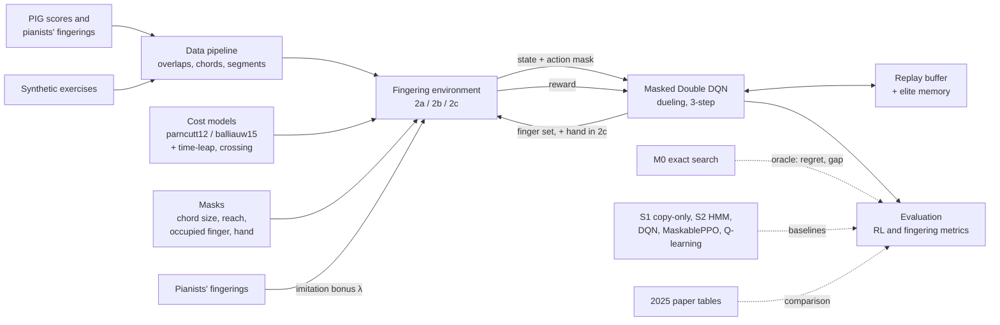

# Fingerly — model-free deep RL for piano fingering

Fingerly assigns a **hand** (left or right) and a **finger** (1 = thumb … 5 = little finger) to
every note of a symbolic score, using deep reinforcement learning on the PIG dataset.

| Part | What it is | Status |
| --- | --- | --- |
| **A** | Reproduction of Iman & Ahn (2024): right hand, monophonic, DQN / DDQN / PG / A2C on four pieces | **Done** (results in §A.6) |
| **B** | One hand at a time: a masked Double DQN on the whole of PIG, with a train/val/test split | Implemented |
| **C** | **Current version: both hands, with chords and hand assignment, one shared RL policy, on a low compute budget**, compared against Iman & Ahn (2025) | Specified here, to be implemented |

## Setup

```bash
python -m venv .venv && source .venv/bin/activate
pip install -r requirements.txt
pytest -q                       # a few minutes; includes a short DQN training run
```

Get PIG from <http://beam.kisarazu.ac.jp/research/PianoFingeringDataset/>. It requires the usage
agreement, so do not commit it. Unzip it, for example to `data/PianoFingeringDataset_v1.2`.
`--pig-dir` can point at the root or straight at `FingeringFiles/`.

No dataset yet? `python -m fingerly.fake_pig --out data/fake_pig` writes a fake dataset in PIG
format so you can test the pipeline. The numbers it produces are meaningless.

---

# Part A — Reproduction of Iman & Ahn (2024)

A. P. Iman, C. W. Ahn, *"A Model-Free Deep Reinforcement Learning Approach to Piano Fingering
Generation"*, IEEE CAI 2024, pp. 31–37, DOI 10.1109/CAI59869.2024.00016.

## A.1 What the paper did

| Item | Paper |
| --- | --- |
| Task | Right hand only, monophonic, one finger (1–5) per note |
| Environments | V0–V3, one piece each (§A.2); one pass through the piece per episode |
| State | (n_{t−2}, a_{t−2}, n_{t−1}, a_{t−1}, n_t): MIDI notes and fingers, one-hot over 88 keys and 5 fingers. The paper says 1×273; it is 274 (§A.7) |
| Action | Finger 1–5, **no action mask** |
| Reward | −Σ of the 12 Parncutt et al. (1997) rules, using the paper's Table I (§A.3) |
| Algorithms | DQN, Double DQN, REINFORCE with a value baseline ("PG"), A2C |
| Networks | MLP 512 → 256 → 64, ReLU; Q head 5 outputs, V head 1, policy head 5 with softmax |
| Training | 500 episodes, γ = 0.99, Adam with lr 0.001, MSE loss; DQN/DDQN: replay 10,000, batch 32, target sync every 100 steps |
| Runs and metrics | 10 runs per cell; difficulty per note L = D / N; match rates Mgen, Mhigh, Msoft, Mrec |

## A.2 Pieces

| Env | Piece | Source |
| --- | --- | --- |
| V0 | Beyer, Op. 101 No. 12 | Not in PIG; transcribed at `data/paper/V0_beyer_op101_no12_fingering.txt`. 29 notes; optimum total 18, so L = 0.6207 |
| V1 | Chopin, Waltz Op. 64 No. 1 | PIG (ID in `data/paper/pieces.json`) |
| V2 | Beethoven, *Für Elise* | PIG |
| V3 | Scarlatti, Sonata K. 208 | PIG |

Only the right hand is used. Substitutions such as `3_1` take their first finger.

## A.3 Reward: the 12 rules

**Distance convention.** For a finger pair (i, j) with i < j, the distance is
d = pitch(finger j) − pitch(finger i), in semitones. Rules 1–3 use notes (t−1, t). Rules 4–5 use
notes (t−2, t).

**Table I (right hand, semitones, as printed in the paper):**

| Pair | MinPrac | MinComf | MinRel | MaxRel | MaxComf | MaxPrac |
| --- | --- | --- | --- | --- | --- | --- |
| 1-2 | −5 | −3 | 1 | 5 | 8 | 10 |
| 1-3 | −4 | −2 | 3 | 7 | 10 | 12 |
| 1-4 | −3 | −1 | 5 | 9 | 12 | 14 |
| 1-5 | −1 | 1 | 7 | 10 | 13 | 15 |
| 2-3 | 1 | 1 | 1 | 2 | 3 | 5 |
| 2-4 | 1 | 1 | 3 | 4 | 5 | 7 |
| 2-5 | 2 | 2 | 5 | 6 | 8 | 10 |
| 3-4 | 1 | 1 | 1 | 2 | 2 | 4 |
| 3-5 | 1 | 1 | 3 | 4 | 5 | 7 |
| 4-5 | 1 | 1 | 1 | 4 | 3 | 5 |

**Rules:**

1. **Stretch:** 2 points per semitone outside [MinComf, MaxComf].
2. **Small span:** per semitone below MinRel, 1 point for pairs with the thumb, 2 for other pairs.
3. **Large span:** per semitone above MaxRel, 1 point for pairs with the thumb, 2 for other pairs.
4. **Position-change count:** 1 point if notes t−2 and t are outside [MinComf, MaxComf]. +1 if
   note t−1 lies between them, is played by the thumb, and the distance is outside
   [MinPrac, MaxPrac].
5. **Position-change size:** 1 point per semitone that notes t−2 and t fall outside
   [MinComf, MaxComf].
6. **Weak finger:** 1 point for finger 4 or 5.
7. **Three-four-five:** 1 point when fingers 3, 4 and 5 all occur in three consecutive notes, in
   any order.
8. **Three-to-four:** 1 point for finger 4 right after finger 3.
9. **Four-on-black:** 1 point when fingers 3 and 4 are consecutive, with 3 on white and 4 on black.
10. **Thumb-on-black:** 1 point, +2 if the next note is white, +2 if the previous note is white.
11. **Five-on-black:** 2 points if the previous note is white, +2 if the next note is white.
12. **Thumb passing:** 1 point for a pass on the same level (white–white or black–black). +3 if the
    lower note is white with a non-thumb finger and the upper note is black with the thumb.

## A.4 Reward checks (no training needed)

```bash
python reproduce.py check-reward --pig-dir data/PianoFingeringDataset_v1.2
```

1. **V0, composer's fingering = 18 exactly:** 9 points from rule 6, 6 from rule 7 and 3 from rule 8.
2. **Human L matches the paper's Table II:** 1.8419 (V1), 4.0441 (V2), 2.9155 (V3). Every annotator
   is scored, and the one that matches is reported.
3. **The exact second-order DP never goes below 18 on V0**, and gives the floor for every piece.

## A.5 Run

```bash
python reproduce.py pieces --pig-dir data/PianoFingeringDataset_v1.2
python reproduce.py train --env all --algo all --runs 10 --out runs/paper
python reproduce.py report --runs runs/paper --pig-dir data/PianoFingeringDataset_v1.2 --out results/paper
```

Defaults: `--episodes 500 --gamma 0.99 --lr 1e-3 --buffer 10000 --batch 32 --target-sync 100
--eps-start 1.0 --eps-end 0.01 --eps-decay 0.999 --same-finger zero-span --table1 paper`.

## A.6 Results

The grid is 160 runs: 4 pieces × 4 methods × 10 runs. Each run is scored by its **best training
episode**, which is how the paper's numbers appear to be reported. Cells show **ours / paper**.

**Best L over 10 runs** (lower is better):

| | V0 (Beyer) | V1 (Chopin) | V2 (Für Elise) | V3 (Scarlatti) |
| --- | --- | --- | --- | --- |
| DQN | 0.621 / 0.621 | 1.335 / 1.372 | 3.059 / 3.181 | 2.500 / 2.544 |
| DDQN | 0.621 / 0.621 | 1.349 / 2.516 | 3.221 / 5.265 | 2.662 / 3.25 |
| PG | 2.86 / 8.10 | 5.13 / 10.71 | 8.93 / 14.48 | 6.22 / 11.29 |
| A2C | 5.52 / 2.76 | 6.01 / 3.89 | 8.18 / 7.04 | 10.88 / 6.62 |
| Exact optimum (our rules) | 0.621 | 1.219 | 2.603 | 1.897 |

**Mean ± std of L over 10 runs:**

| | V0 | V1 | V2 | V3 |
| --- | --- | --- | --- | --- |
| DQN | 0.78 ± 0.12 / 1.26 ± 0.91 | 1.37 ± 0.04 / 1.51 ± 0.17 | 3.32 ± 0.20 / 3.78 ± 0.30 | 2.87 ± 0.17 / 3.14 ± 0.53 |
| DDQN | 0.93 ± 0.21 / 0.70 ± 0.24 | 1.40 ± 0.05 / 2.92 ± 0.21 | 3.51 ± 0.17 / 6.05 ± 0.78 | 3.31 ± 0.46 / 3.76 ± 0.35 |
| PG | 3.74 ± 0.66 / 9.71 ± 1.27 | 6.59 ± 1.13 / 11.61 ± 0.39 | 10.50 ± 1.04 / 16.5 ± 0.98 | 7.36 ± 0.76 / 13.38 ± 1.05 |
| A2C | 7.55 ± 1.15 / 3.74 ± 2.76 | 9.90 ± 2.09 / 5.08 ± 0.83 | 13.29 ± 2.65 / 8.94 ± 1.33 | 12.07 ± 0.93 / 7.75 ± 0.56 |

**Match rates (%), averaged over V1–V3** (higher is better):

| | Mgen | Mhigh | Msoft | Mrec |
| --- | --- | --- | --- | --- |
| DQN | 55.9 / 66.5 | 60.2 / 69.0 | 69.9 / 78.5 | 66.9 / 72.6 |
| DDQN | 55.5 / 58.2 | 59.2 / 61.1 | 69.5 / 70.3 | 66.4 / 62.3 |
| PG | 29.0 / 24.2 | 31.1 / 27.0 | 37.5 / 34.6 | 34.2 / 28.2 |
| A2C | 24.8 / 43.1 | 26.6 / 46.3 | 32.9 / 54.2 | 29.4 / 47.0 |
| Exact optimum | 62.1 / – | 66.7 / – | 77.2 / – | 73.7 / – |
| FHMM1 (paper only) | – / 63.5 | – / 66.1 | – / 79.5 | – / 74.2 |

**How this compares with the paper:**

- **Reproduced.**
  - DQN's difficulty matches the paper within about 5%.
  - DQN and DDQN both find the V0 optimum (−18). It took us until episode 229; the paper reports
    episodes 124 and 202.
- **Partly reproduced.** The paper's ordering is DQN ≤ DDQN < A2C < PG. DQN ≤ DDQN holds, but our
  A2C and PG come out the other way round.
- **Not reproduced.** Our match rates are about 10 points below the paper's DQN. Even the exact
  optimum under our rules reaches only 62.1% Mgen, so the gap most likely comes from how the rules
  are implemented, not from training.
- **Open hypothesis.** If V0 is included in the average at 100% (the composer's fingering, which
  DQN matches exactly), our DQN comes out at about 66.9% Mgen, close to the paper's 66.5%. This
  does not explain the paper's DDQN number.

## A.7 Choices the paper left open (and what we used)

1. Input size: 274, not 273.
2. Same finger on a different key: `zero-span`, i.e. all six limits are 0, so rules 1–3 charge per
   semitone moved. Without a cost here, all-finger-2 scores 0 on V0.
3. Table I row 4-5 has MaxRel (4) > MaxComf (3); we use it as printed.
4. Exploration: ε decayed per step by a factor of 0.999, from 1.0 to a floor of 0.01.
5. Missing notes at the start of a piece are encoded as zero one-hot blocks.
6. Rules 10 and 11 use the next note even though the state does not contain it; kept as written.
7. Thumb passing is read as a crossing: the thumb plays one of two consecutive notes, and the finger
   order is inverted relative to the pitch order.
8. PG updates once per episode with Monte-Carlo returns; A2C updates every step with a one-step TD
   advantage.
9. Results use the best training episode; `report` also logs the final greedy policy.
10. Table V is averaged over V1–V3, with every annotator scored.

**Lessons carried into Part C:**
- DQN and DDQN are the main learners.
- A reward made of rules alone has a ceiling on human-likeness. This motivates the imitation term
  λ.

---

# Part B — Fingerly stage 1 (one hand, whole of PIG)

One hand at a time (`--hand R` or `--hand L`), on monophonic passages from all of PIG. A masked
Double DQN gives every note a finger, trained on a simplified ergonomic reward.

### How Part B differs from the paper

| | Paper (Part A) | Part B |
| --- | --- | --- |
| Data | 4 pieces; train and test on the same piece | All monophonic PIG passages; train/val/test split, with the 30 multi-annotator pieces as test |
| State | One-hot (274) | 24 relative features, including a 3-note look-ahead |
| Reward | 12 rules | Simplified cost table, plus an optional expert bonus λ |
| Actions | Unmasked | Masked to feasible fingers |
| Agent | DQN / DDQN / PG / A2C | Double DQN with a dueling head and n-step returns |

### Run

```bash
python train.py --pig-dir data/PianoFingeringDataset_v1.2 --hand R --seed 0 --out runs/rh_ddqn_s0
python evaluate.py --pig-dir data/PianoFingeringDataset_v1.2 --ckpt "runs/rh_ddqn_s*/best.pt" --show 2 --out results/rh.json
python plot.py runs/rh_ddqn_s0 --out results/curves.png
python predict.py --ckpt runs/rh_ddqn_s0/best.pt --input .../FingeringFiles/001-1_fingering.txt --output out/001.txt
python visualize.py --ckpt runs/rh_ddqn_s0/best.pt --input .../FingeringFiles/001-1_fingering.txt
bash run_seeds.sh data/PianoFingeringDataset_v1.2
```

Useful switches:
- `--no-double --no-dueling`: plain DQN
- `--lam 0.5`: expert-match bonus
- `--synthetic 500`: add scales, arpeggios and melodies
- `--no-mask`: ablation in which the agent can make impossible moves and pays the penalty
- `--span-scale 0.85`: a smaller hand
- `--select-by match`: keep the checkpoint with the best validation Mgen
- `--steps`, `--lr`, `--n-step`

### Design

**Data.**
- Notes and hands come from annotator 1.
- A passage continues while each note starts after the previous note of that hand has ended.
  Chords and held notes end the passage.
- Passages need at least 8 notes.
- Test = the 30 multi-annotator pieces; 12 seeded validation pieces; the rest are training.

**State (24 numbers).**
- The current note.
- The next 3 notes.
- The hand: its last two keys and fingers.

Left-hand intervals are mirrored.

**Reward.** `−α·C_effort − β·P_impossible + λ·B_expert`, using this cost table:

| Event | Cost |
| --- | --- |
| Each semitone outside the comfortable span | 1 |
| Finger 4 or 5 | 1 |
| Thumb on a black key | 1 |
| A crossing | 1 |
| Same finger on a different key | 2 |
| Impossible move | 10 |

Two extra rules:
- **Out of reach → hand shift.** If no other finger can reach the next key, every finger is
  allowed and the move costs 2.
- **Repeated note with a new finger** is always allowed and is scored by the comfort rule.

**Baselines.** Random-valid, greedy, optimal-cost DP, and a simplified first-order HMM.

**Metrics.** A note matches only if both hand and finger agree. Mgen, Mhigh and Msoft are computed
per piece, then averaged. Human leave-one-out agreement is the ceiling. The playability metrics are
effort per note, impossible-move rate, crossing rate, shift rate and weak-finger rate.

---

# Part C — Two hands with deep RL (current version)

This part is the complete specification of the current version and is meant to be implemented
from directly. It builds on Part A's rules and results and on Part B's code.

## C.1 Goal

Reach the results of Iman & Ahn (2025) on the same 30 PIG pieces, for both hands:

- difficulty about as low as theirs (relative to the human fingering, §C.11.4);
- general match rate **Mgen ≥ 0.62**.

Three constraints:

1. **RL is the method.** A masked Double DQN learns from a reward by acting in a fingering
   environment. Search and supervised models are only measuring sticks and baselines.
2. **Low compute.** About **45 CPU-hours** for the whole project, including the full evaluation
   (§C.12). That is about 8–9 hours on a 6-core laptop running 6 jobs at once, i.e. one or two
   nights. No single run is longer than 2 hours. The 2025 paper used about 45 GPU-days.
3. **Unseen test pieces.** One policy is trained on many pieces and tested on pieces it has never
   seen. The 2025 paper trained one model per test piece.

**Beyond the 2025 paper**, this version adds:
- hand assignment (the agent chooses the hand);
- generalisation to unseen pieces;
- an exact optimum to measure the agent against;
- an imitation reward aimed at the match-rate gap;
- time-aware costs for large leaps, a failure case they report.

---

## C.2 Quick start

After the setup above, run in this order (§C.13 has every command):

```bash
python prepare_twohand.py --pig-dir data/PianoFingeringDataset_v1.2 --report results/twohand/coverage.md
python check_reward.py --pig-dir data/PianoFingeringDataset_v1.2 --cost balliauw15 --table-a1 data/twohand/eer2025_table_a1.csv
python search.py      --pig-dir data/PianoFingeringDataset_v1.2 --split test --mode given --out results/twohand/m0.json
python train_bc.py    --pig-dir data/PianoFingeringDataset_v1.2 --mode given --seed 0 --out runs/s1_s0
python train.py       --pig-dir data/PianoFingeringDataset_v1.2 --mode given --lam 0.5 --elite 1 --seed 0 --out runs/r3_s0
python evaluate.py    --pig-dir data/PianoFingeringDataset_v1.2 --split test --mode given --ckpt "runs/r3_s*/best.pt" "runs/s1_s*/best.pt" --wilcoxon --out results/twohand/main.json
```

---

## C.3 Where the RL is

### C.3.1 The MDP

| Element | Definition |
| --- | --- |
| Episode | One **segment** of a piece (§C.4.5), played event by event |
| Event | What the agent fingers in one step: a single note, or a chord (several notes struck together by one hand) |
| State | Relative features (§C.7): the current event, a 4-event look-ahead, each hand's recent keys and fingers, chord size and span |
| Action | A **finger set** for the current event (§C.5): 31 masked actions per hand; 62 when the agent also chooses the hand |
| Transition | Deterministic: move to the next event of the score; the hand's state is updated with the chosen fingers |
| Reward | −(difficulty rules + time-leap + crossing) + λ · (match with a pianist) (§C.6) |
| Objective | Maximise the discounted return over the segment, γ = 0.99 |
| Learner | Masked Double DQN with a dueling head and 3-step returns (§C.9) |

### C.3.2 What is RL and what is not

| Component | RL? | Role |
| --- | --- | --- |
| R1–R4 and 2c (§C.9.2) | **Yes** | The method |
| M0: exact DP / beam search (§C.8) | No | Measuring stick only: the best possible difficulty, and the agent's gap to it. Never used to train the main method |
| S1: copy-only model (behaviour cloning) | No | Baseline. RL must beat it |
| S2: first-order HMM per hand | No | Baseline |
| A1–A3 accelerators (§C.9.3) | Partly | Optional speed-ups, off by default, each reported as an ablation |

### C.3.3 Why RL rather than copying pianists

1. **Two goals at once.** Copying knows nothing about playability and can output hard or
   impossible moves. RL optimises playability (the rules) and human-likeness (λ) together.
2. **Consequences across the sequence.** A finger chosen now changes the cost of the next notes.
   RL is trained on the return over the whole segment; copying predicts one note at a time.
3. **Delayed costs.** The time-leap cost, retroactive rule charges (§C.6.4) and the hand choice all
   show their cost later. Crediting a later cost to the earlier choice is what RL is for.

This is **tested**, not assumed (§C.11.5, §C.11.6, §C.11.9).

### C.3.4 System diagram



---

## C.4 Data pipeline (`fingerly/twohand/prepare.py`)

### C.4.1 Parse

Use the Part B reader: spelled pitch → MIDI; finger sign → hand (positive = right, negative =
left); a substitution such as `3_1` → its first finger. Notes, onsets, offsets and hands come from
**annotator 1**. Every annotator's fingers are kept per note for the imitation bonus and the
metrics.

### C.4.2 Overlap tolerance (within one hand, before chord grouping)

For notes i and j of the same hand with onset_j > onset_i:

- **Legato overlap.** If onset_j − onset_i > `chord_tol` and offset_i − onset_j ≤ `overlap_tol`,
  set offset_i = onset_j: the notes are sequential.
- **Held note.** If the overlap is longer than `overlap_tol`, note i is held under j. Clip offset_i
  to onset_j and mark note i's finger **occupied** until note i's original offset (§C.5.3).
- Defaults: `--chord-tol 0.03 --overlap-tol 0.05` (seconds). Before fixing them, plot the
  within-hand onset-difference and overlap-length histograms on training pieces and pick the values
  where the distributions separate.

### C.4.3 Events and chords

- Within one hand, notes whose onsets lie within `chord_tol` of the first note form one **chord
  event**; all its notes belong to that hand.
- Chord size C_t ∈ {1, …, 5}. A chord with more than 5 notes keeps its 5 lowest (right hand: 5
  highest) and logs the case.
- `--chords full` (default): the agent fingers every note of the chord (§C.5.1).
- `--chords reduce`: keep one note — the lowest for the left hand, the highest for the right — and
  store the chord's size, span and dropped notes on the event (§C.5.4).

### C.4.4 Streams

- **Hand stream:** one hand's events in onset order.
- **Merged stream:** both hands' events in onset order. Ties: left hand first, then lower pitch.

### C.4.5 Segments

Cut the merged stream where both hands rest for more than `--rest-gap 1.5` s, or at
`--max-len 256` events; drop segments shorter than `--min-len 16`. Pieces are never split across
train, validation and test.

### C.4.6 Splits

- **Test: the 2025 paper's 30-piece subset**, PIG IDs
  002, 017, 025, 031, 033, 034, 038, 042, 052, 053, 066, 067, 069, 074, 077, 081, 085, 092, 094,
  101, 102, 107, 110, 112, 114, 119, 123, 136, 141, 148.
  Never trained on.
- **Validation:** 12 other PIG pieces, seeded.
- **Training:** the remaining PIG pieces (about 108), plus synthetic exercises (§C.4.7).
- The 2025 paper's 69-piece filter is **not** applied to training.
- `data/twohand/eer2025_table_a1.csv` lists all 69 pieces of their Table A1: PIG ID, number of
  pianists, the human difficulty total, and whether the piece is in the 30-piece subset.

### C.4.7 Synthetic exercises (`fingerly/synth.py`, extended)

Label-free training material: contrary-motion scales; left-hand Alberti bass and broken chords;
arpeggios over more than 2 octaves split between the hands; melodies passed between the hands;
block chords of 2–4 notes in either hand. The generator sets each event's hand. Synthetic events get
no imitation bonus and are never used in the metrics.

### C.4.8 Coverage report (`results/twohand/coverage.md`)

Per hand: fraction of notes fingered, number of segments, mean segment length, share of chord
events, share of held notes — under (1) Part B's filter, (2) overlap tolerance only, (3) overlap
tolerance + chords. This justifies the data choices in the report.

---

## C.5 Actions and masks

### C.5.1 Finger-set actions

- An action is a set of C_t distinct fingers. There are C(5, C_t) sets per chord size:
  5 + 10 + 10 + 5 + 1 = **31 actions** per hand, indexed in a fixed table.
- The set is assigned to the chord's notes **in pitch order**: from the lowest note upward, the
  right hand uses its fingers in ascending order, the left hand in descending order.
- In step 2c the agent also chooses the hand: action = hand × finger set, **62 actions**.
- The Double DQN target takes the maximum over the actions allowed at the next event (its own chord
  size and masks). This is the 2025 paper's per-chord-size heads expressed as one masked output
  layer.

### C.5.2 Chord-size mask

Only the C(5, C_t) sets of the current event's size are allowed.

### C.5.3 Feasibility masks

1. **Chord reach.** A set is allowed only if every adjacent pair of fingers in the chord can span
   its interval within [MinPrac, MaxPrac] (cost model's limits, mirrored for the left hand).
2. **Occupied fingers.** A finger holding a key (§C.4.2) cannot be used until that key's original
   offset.
3. **Out-of-reach shift.** If no finger set can be reached from the hand's current fingers, the
   hand must jump: all sets of the right size are allowed, and the move costs 2 (as in Part B).
4. **Hand masks (2c only).**
   - A hand whose key is still sounding at the event's onset (beyond `overlap_tol`) is masked.
   - An event starting within `chord_tol` of the previous event must take the other hand.
   - **Chord events keep their annotated hand.** Only single-note events get a hand choice.

If every action is masked, allow the out-of-reach shift and log the event.

### C.5.4 Reduced chords (`--chords reduce`)

The kept note gets one finger f, allowed only if f ≥ k (k = chord size, so enough fingers remain
for the dropped notes) and the chord's span ≤ MaxPrac(1, f), with the thumb on the other extreme.
If no finger passes, allow f = 5 and log it as an unreachable chord.

---

## C.6 Reward (`fingerly/twohand/rules.py`)

R_t = −( α · D_t + c_time + c_cross ) + λ · B_t, with α = 1.

D_t is the difficulty of event t under the chosen cost model (§C.6.1 or §C.6.2). Train with one model
and **report difficulty under both**.

### C.6.1 Cost model `parncutt12` (Part A rules, extended)

Table I, the 12 rules and the reproduction's choices are those of Part A (§A.3 and §A.7),
including `zero-span` for the same finger on a different key.

**Extensions for two hands and chords:**

- **Left hand:** negate all intervals before applying Table I; key colour is unchanged.
- **Per-hand history:** in every rule, t−1 and t−2 are **that hand's** previous events, not the
  previous events of the merged stream.
- **Chords** (`--chords full`), using the 2025 paper's approach:
  - *Within a chord:* rules 1–3 applied to each adjacent pair of fingers in the chord, at double
    score.
  - *Between events:* rules 1–3 applied to every pair (note of the previous event, note of the
    current event) and summed (`--chord-horizontal all`). The alternative `extremes` uses only the
    lowest and highest notes. This reading is an assumption; choose with the reward check (§C.6.6).
  - Rules 4–12 apply only when the events involved are single notes.

### C.6.2 Cost model `balliauw15` (the 2025 paper's rules, for comparison)

**Distance unit.** Distances are measured on a keyboard with an **invisible black key** between E–F
and B–C, so an octave is 14 units:

| Pitch class | C | C♯ | D | D♯ | E | (·) | F | F♯ | G | G♯ | A | A♯ | B | (·) |
| --- | --- | --- | --- | --- | --- | --- | --- | --- | --- | --- | --- | --- | --- | --- |
| Position | 0 | 1 | 2 | 3 | 4 | 5 | 6 | 7 | 8 | 9 | 10 | 11 | 12 | 13 |

position(MIDI) = 14 · (MIDI div 12) + table[MIDI mod 12].

**Right-hand limits** (their Eq. 8; row f = from finger, column g = to finger, positive = ascending):

```
MaxPrac_R          MaxComf_R          MaxRel_R
 0 11 15 16 18      0  9 13 14 16      0  6  9 11 12
10  0  7  8 12      8  0  5  6 10     -1  0  2  4  6
 8 -1  0  4  8      6 -1  0  2  6     -3 -1  0  2  4
 6 -1 -1  0  6      4 -1 -1  0  4     -5 -3 -1  0  2
 2 -2 -1 -1  0      0 -2 -1 -1  0     -7 -5 -3 -1  0
```

- Min*_R(f, g) = −Max*_R(g, f) for each of Prac, Comf, Rel.
- **Left hand:** swap the finger order, X_L(f, g) = X_R(g, f).

**Rules** (their Table 1; "unit" = one position beyond the limit; "mono" = the events involved are
single notes):

| # | Applies to | Points |
| --- | --- | --- |
| 1 | all, t−1 → t | 2 per unit below MinComf or above MaxComf |
| 2 | all, t−1 → t | 1 per unit below MinRel or above MaxRel |
| 3 | all, t−1 → t | 10 per unit below MinPrac or above MaxPrac |
| 4 | all | 1 if the same key is replayed with a different finger |
| 5 | mono | 1 if finger 4 is used |
| 6 | chords | rules 1–3 within the chord, at double score |
| 7 | mono, t−2 → t | (a) 1 if outside [MinComf, MaxComf]; (b) +1 if n_{t−2} < n_{t−1} < n_t, finger 1 is involved as written in the paper, and outside [MinPrac, MaxPrac]; (c) +1 if n_{t−2} = n_t with different fingers |
| 8 | mono, t−2 → t | 1 per unit below MinComf or above MaxComf |
| 9 | mono | 1 if n_{t−2} ≠ n_t, same finger at t−2 and t, and n_{t−2} < n_{t−1} < n_t |
| 10 | mono | 1 if fingers 3 and 4 are consecutive, either order |
| 11 | mono | 1 if 3 and 4 are consecutive with 3 on a black key and 4 on a white key |
| 12 | mono | 2 if a white key played by a non-thumb is followed by a black key played by the thumb |
| 13 | mono | 1 if a non-thumb finger is followed by the thumb |
| 14 | mono | thumb on black: 0.5, +1 if the previous note is white, +1 if the next note is white |
| 15 | mono | finger 5 on black: +1 if the previous note is white, +1 if the next note is white |

Rule 7(b)'s exact condition is ambiguous in the paper; implement it as printed and let the Table A1
check (§C.6.6) decide.

### C.6.3 Inter-hand and timing terms (both cost models)

- **Hand position.** Thumb key estimated from the hand's last event, with a five-finger offset
  Δ = [0, 2, 4, 5, 7] semitones for fingers 1–5: right thumb = key − Δ[f]; left thumb =
  key + Δ[f]. A hand that hasn't played has no position; the terms are skipped for it.
- **Time-leap:** c_time = w_time · max(0, |shift| − v_max · Δt), where shift is the change in the
  playing hand's thumb position since its previous event and Δt the onset gap. w_time = 1; v_max =
  the **95th percentile of human hand speed** on the training pieces.
- **Crossing (2c; 2b only with `--cross`):** c_cross = w_cross · max(0, thumb_L − thumb_R −
  margin), w_cross = 1 per semitone, margin = 2.
- **Hand switching:** no direct cost. Monitor the switch rate against the humans'; add
  w_switch · [hand changed and Δt short] only if the agent switches far more often.

### C.6.4 Retroactive charges

Rules that look at the **next** note of the same hand (Part A rules 10–11, `balliauw15` rules
14–15) can't be charged immediately in 2c, because that hand's next note depends on later hand
choices. Charge them when that hand's next event arrives. In 2a and 2b the next event is known and
is charged immediately. Unit test: both ways give the same total on the same fingering.

### C.6.5 Imitation bonus

B_t = 1 if the chosen finger set (and, in 2c, the hand) matches **any** annotator on this event,
otherwise 0. For chords, all of the chord's fingers must match. Training pieces only; validation
and test are scored without it. λ ∈ {0, 0.25, 0.5, 1, 2}.

### C.6.6 Reward checks (`check_reward.py`, no training)

1. **Table A1 check.** Score the pianists' fingerings of the 30 test pieces under `balliauw15`,
   taking the lowest-difficulty annotator when there are several, as they do. Compare per piece with
   `data/twohand/eer2025_table_a1.csv`. Pass: within 5% on at least 25 of 30 pieces. Report the
   per-hand and whole-piece totals, since the paper doesn't say which it uses.
2. **Mirror test.** A left-hand line mirrored from a right-hand line gets the same breakdown; for
   `balliauw15`, finger-swap and interval mirroring agree.
3. **Chord masks.** Fewer than 2% of the pianists' chord fingerings are rejected by §C.5.3. If more,
   the reach test is too strict.
4. **v_max.** Human fingerings pay a time-leap cost on fewer than 5% of events.
5. **Part A regression.** On the Part A right-hand pieces, `parncutt12` gives the same numbers as
   Part A.

---

## C.7 State (`fingerly/twohand/features.py`)

| Group | Features |
| --- | --- |
| Current event | register (distance from middle C / 24); black?; chord size C_t / 5; span / 12; onset gap to the previous event; overlaps a held note? |
| Look-ahead, K = 4 events | for each: interval to each hand's last key / 12; black?; chord size / 5; onset gap; exists?; (2b) its given hand |
| Each hand | played yet?; interval from its last key / 12; last finger set (5 bits); finger set before that (5 bits); interval from the key before that / 12; time since it last played; holding a key?; thumb position relative to the current event / 12 |
| Mode | hand flag of the current event (2a, 2b); zero in 2c |

Left-hand intervals are mirrored inside that hand's features, so **one network fingers both hands**.
For chords, "key" means the lowest note (left hand: highest), so intervals are measured from the
thumb side. About 100 numbers; make the count a config value.

---

## C.8 Optimum reference M0 (`fingerly/twohand/search.py`)

| Mode | Method | Exact? |
| --- | --- | --- |
| 2a; 2b without inter-hand terms | Second-order DP per hand over (finger set at t−1, finger set at t), with the masks | Exact |
| 2b with `--cross`; 2c | Beam search over full two-hand states, beam 10,000 | Near-optimal |

Exact DP for 2c would need each hand's last two events wherever they are in the stream, which is
too large. Check the beam against brute force on segments of ≤ 12 events; it must find the optimum
in at least 99% of cases.

M0 uses the same cost tables as the environment (§C.10). It reports the best possible difficulty and
the agent's **gap to the optimum**, (agent − M0) / M0. It is **not** used to train the main method.

---

## C.9 Methods

### C.9.1 Baselines (not RL)

- **S1 — copy-only model.** The same network and masks as the agent, trained with cross-entropy to
  predict the pianists' finger sets on training pieces. 20 epochs, a few minutes.
- **S2 — first-order HMM per hand** (Part B's `hmm-1st-order`, extended to finger sets).

### C.9.2 RL (the method)

| Method | Configuration |
| --- | --- |
| **R1** | Masked Double DQN, rules only (λ = 0) |
| **R2** | R1 + imitation bonus, λ ∈ {0.25, 0.5, 1, 2}. **The main method** |
| **R3** | R2 + elite replay (below) |
| **R4** | Best of R2/R3, fine-tuned on each test piece for 20–50 episodes, rule reward only |
| **2c** | Best R configuration with hand assignment (62 actions), trunk initialised from 2b |

**Elite replay (R3, adapted from the 2025 paper).**
- Elite memory = **the agent's own best episode for each training segment**, replaced only by a
  higher-return episode on the same segment.
- At most **25% of each batch** comes from elite transitions, sampled uniformly over stored
  segments; the rest from the normal buffer. Their study found quality drops when elites dominate
  the batch.
- `--elite 0` turns it off (= R2).

**2c curriculum.** Short synthetic segments (≤ 32 events) where the hand choice is easy → all
synthetic data → PIG segments.

### C.9.3 Optional accelerators (off by default)

| | Flag | What it does |
| --- | --- | --- |
| A1 | `--bc-init runs/s1_s0/best.pt` | Start RL from S1's weights |
| A2 | `--demos 0.25` | Pianists' episodes in the replay buffer with a DQfD margin loss (margin 0.8); 25% of the batch, decayed to 10% |
| A3 | `--elite-seed-optimum` | Add M0's optimal episode for each training segment to the elite memory. **Uses search in training**; reported separately |

### C.9.4 Hyperparameters (starting values)

| Setting | Value |
| --- | --- |
| Network | Dueling MLP, 256-256, ReLU |
| Optimiser | Adam, lr 3 × 10⁻⁴ |
| Loss | Huber on the n-step Double DQN target |
| γ / n-step | 0.99 / 3 |
| Replay buffer | 500,000 transitions |
| Batch / update frequency | 256 / every 4 environment steps |
| Target network | Soft update, τ = 0.005 |
| Exploration | ε linear from 1.0 to 0.05 over the first 20% of steps |
| Parallel environments | 16 |
| Steps | 1M (2a, 2b), 1.5M (2c) |
| Seeds | 3 (final numbers: 3 per configuration) |
| Model selection | Best validation Mgen (R2–R4); best validation difficulty (R1) |
| Early stopping | Patience 50,000 steps on the selection metric |
| R4 fine-tuning | lr 1 × 10⁻⁴, ε 0.1, 20–50 episodes per test piece |

### C.9.5 RL benchmark algorithms

Compared in §C.11.5. Starting settings:

| Algorithm | Settings |
| --- | --- |
| DQN (`--algo dqn`) | As §C.9.4, but no double, no dueling, n = 1 |
| MaskablePPO (`train_ppo.py`) | sb3-contrib; same features and masks; 16 environments, rollout 2,048 steps per environment, 10 epochs, batch 256, lr 3 × 10⁻⁴, clip 0.2, entropy 0.01, γ 0.99, GAE λ 0.95, 1M steps |
| Tabular Q-learning (`--algo qlearn`) | Per test piece, 500 episodes; α = 0.1, γ = 0.99, ε linear from 1.0 to 0.05; dictionary-backed Q-table; masks applied |

---

## C.10 Speed engineering

1. **Precomputed cost tables.** For each segment, compute once the cost of every
   (finger set before last, last finger set, current finger set) at every event, vectorised in
   numpy, sparse over the masked sets. A step becomes a lookup, and M0 reuses the tables.
2. **Vectorised environments:** 16 per process, one batched forward pass.
3. **Fewer, larger updates:** batch 256 every 4 steps, soft target updates.
4. **Small network:** 256-256; try larger only if it underfits.
5. **Parallel seeds:** one process each, `torch.set_num_threads(1)`.
6. **Early stopping** on the selection metric.

Expected 1,500–3,000 steps/s, i.e. 6–12 minutes per 1M steps. Time 1,000 steps on PIG 033 (their
longest-episode example) before launching the grid, and adjust §C.12.

---

## C.11 Evaluation (`evaluate.py`)

Evaluation has three layers:
- **RL-specific metrics:** does the learning work?
- **Problem-specific metrics:** is the fingering good?
- **The evaluation framework:** benchmarks, ablations, robustness and sensitivity.

### C.11.1 Protocol

- **Frozen greedy policy.** Every evaluation uses ε = 0, no learning, and **no imitation bonus**.
- **Evaluation return.** G = Σ_t r_t over a segment, undiscounted, with the rule reward only.
  Report it **per event** (G divided by the number of events) so segments of different lengths are
  comparable, and as a total per piece.
- **During training:** evaluate on the validation pieces every 25,000 steps.
- **Final numbers:** the selected checkpoint (§C.9.4) on the 30 test pieces.
- **Seeds.** 3 per configuration, and **5 for the main methods** (S1, best R2, R3) for the stability
  analysis. A seed controls network initialisation, ε-greedy exploration, replay sampling, segment
  order and minibatch selection. Set Python, NumPy and PyTorch seeds; the environment itself is
  deterministic. Log every seed.

### C.11.2 RL-specific metrics

| Metric | Definition in this project | Shown as | Better |
| --- | --- | --- | --- |
| **Mean episodic return** | Mean per-event evaluation return over segments and seeds | Learning curve: x = environment steps, y = mean validation return, with a 95% confidence band over seeds. Final table: mean ± std and median on test | ↑ |
| **Success rate** | A test segment **succeeds** if it has **no infeasible transition** and its gap to the optimum (§C.8) is **≤ 10%**. SR = successful segments / all segments. Also report SR_play: no infeasible transition only. Fixed before any experiment | SR against environment steps (validation); final SR with a Wilson 95% interval (test) | ↑ |
| **Cumulative regret** | Per test segment i: r_i = C_i^agent − C_i^\*, where C^\* is M0's optimal cost under the same cost model. R_N = Σ_{i=1}^{N} r_i | Cumulative regret over the test segments (in piece order) for every method; the oracle is the line at 0. In 2c, M0 is a near-optimal beam search, so a few r_i may be slightly negative; report how many | ↓ |
| **Convergence speed** | N\* = the first step N at which the validation gap to the optimum is ≤ 15% for K = 3 consecutive evaluations. For R2–R4, also the first N with validation Mgen ≥ 0.60 for K = 3. "Not reached" if never | Learning curve with the threshold line and N\* marked; N\* in the final table | ↓ |
| **Sample efficiency** | Area under the validation learning curve up to 1M steps, normalised to [0, 1]; validation return at 100k, 250k, 500k and 1M steps; for R4, fine-tuning episodes to reach d_rel ≤ 0.81, against the 2025 paper's 500 per piece | Table, plus the R4 curve | AUC ↑, episodes ↓ |
| **Generalisation gap** | Δ_gen = J_seen − J_unseen. J_seen: training pieces; J_unseen: test pieces; both without the bonus. Computed for per-event return, Mgen and d_rel | Bar chart, seen vs unseen, per method; also after R4 fine-tuning | ↓ (close to 0) |
| **Stability across seeds** | Std, coefficient of variation and min–max over seeds of final test return, Mgen and d_rel; width of the learning-curve band | Table and box plot (5 seeds for the main methods) | ↓ |
| **Computational efficiency** | Training wall-clock time and CPU-hours; environment steps per second; inference time per note and per piece; number of parameters; peak RAM; whether the GPU was used; optional energy estimate (CPU package power × time) | Table, against the 2025 paper's ~45 GPU-days and against M0's beam search time per piece | ↓ at equal quality |

### C.11.3 Problem-specific metrics

| Metric | What it means | Desired |
| --- | --- | --- |
| Mgen / Mhigh / Msoft / Mrec | Agreement with the pianists; a note matches only if hand and finger agree; chord notes are matched one by one; per piece, averaged over pieces; overall, per hand, single notes vs chords | ↑ (ceiling: agreement between annotators) |
| Hand accuracy (2c) | Share of notes given the pianist's hand | ↑ (ceiling: annotator agreement) |
| Chord exact match | Share of chords where every finger matches an annotator | ↑ |
| Difficulty | Per note and total per piece, under `parncutt12` and `balliauw15` | ↓ |
| d_rel | Difficulty ÷ the human fingering's difficulty, `balliauw15` (§C.11.4) | ↓ (target ≤ 0.81) |
| Gap to optimum | (agent − M0) / M0 | ↓ ideally 0 |
| Infeasible-move rate | Transitions outside MinPrac/MaxPrac, or forced fallbacks | ↓ ideally 0 (target < 1%) |
| Large-stretch rate | Transitions outside [MinComf, MaxComf] | ↓ |
| Crossing rate (2c) | Events with the left hand above the right | ↓ |
| Time-leap rate | Moves faster than v_max | ↓ |
| Hand-switch rate | Changes of hand between consecutive single notes | close to the humans' rate |
| Weak-finger and thumb-on-black rates | Use of fingers 4–5; thumb on black keys | close to the humans' rates |
| Unreachable chords | Chords where no finger set passed the reach mask | ↓ ideally 0 |
| Sequence breakdowns | Passages where the per-note choice matches the pianist but the next transition is infeasible or very hard | ↓ ideally 0 |

### C.11.4 Comparing with the 2025 paper

Their reported numbers on the 30-piece subset (Table 5):

| Method | Difficulty | Mgen | Mhigh | Msoft | Mrec |
| --- | --- | --- | --- | --- | --- |
| Uniform replay | 30.34 | 0.62 | 0.67 | 0.75 | 0.70 |
| EER | 30.43 | 0.61 | 0.66 | 0.75 | 0.69 |
| PER | 31.40 | 0.59 | 0.67 | 0.75 | 0.69 |
| FHMM2 | 36.25 | 0.70 | 0.74 | 0.85 | 0.80 |
| Human | 37.47 | 0.73 | 0.75 | 0.79 | 0.77 |

**Their difficulty numbers are not consistent with each other.** The mean of their own Table A1
human difficulties over this subset is **60.5**, not the 37.47 of Table 5. (Their Table 4 gives 60.60
for "69 pieces", but the 69-piece mean of Table A1 is 95.5.) So absolute difficulties can't be
compared reliably. Compare **relative difficulty** instead:

  d_rel = (your difficulty) / (human difficulty), both under `balliauw15`, on the same pieces.

Their Table 5 gives d_rel = 0.81 for Uniform and EER, 0.84 for PER, 0.97 for FHMM2.

### C.11.5 Comparison with benchmark methods

The problem has **discrete actions**, so the RL benchmarks are the standard discrete-action family:
Q-learning, DQN, Double DQN and PPO.

| Group | Method | Setting | Why it's included |
| --- | --- | --- | --- |
| RL | **Tabular Q-learning** (`--algo qlearn`) | Per test piece, 500 episodes, discrete state = (last two keys relative to the current one, last two finger sets, current event) per hand | The classic baseline; works per piece but has no function approximation, so it can't generalise |
| RL | **DQN** (`--algo dqn`) | Shared policy; no double, no dueling, 1-step | The algorithm of the 2024 paper |
| RL | **Double DQN** (ours, R1–R4) | Shared policy; dueling, 3-step, masks | The method |
| RL | **MaskablePPO** (`train_ppo.py`, sb3-contrib) | Shared policy, same features, masks and step budget | The on-policy representative; Part A's A2C and PG did poorly, so this checks on-policy learning with masking |
| Non-RL | Random-valid, greedy, S1 (copy-only), S2 (HMM) | Same test pieces | Floors and supervised baselines |
| Reference | M0 (exact DP / beam search) | Same test pieces | The oracle for regret and the gap |
| Published | Iman & Ahn (2025): Uniform, EER, PER, FHMM1–3 | Their Table 5 | The target (§C.11.4) |

**Discuss why** each one does as it does. Points to examine:
- **Off-policy value methods fit this problem.** The actions are discrete and masked, and replay
  reuses experience across pieces. Elite replay is only possible off-policy.
- **PPO discards data after each update.** Check whether masking narrows the gap that Part A saw for
  on-policy methods.
- **Tabular Q-learning can't transfer.** Its table doesn't carry over to unseen pieces; only
  per-piece training works, and it is compared in that setting.
- **Plain DQN vs Double DQN.** Part A found them close on single pieces; check whether that holds
  across many pieces.

### C.11.6 Ablation study

The **full method** is R3 at the best λ: masks, time-leap term, crossing term (2c), 4-event
look-ahead, 3-step returns, Double + dueling, full chords and overlap tolerance. Each variant
**removes or replaces one component** and is trained with 2 seeds:

| Variant | Component removed or replaced | What it tests |
| --- | --- | --- |
| Full method | — | Reference |
| − imitation bonus | λ = 0 | Expect lower difficulty but lower Mgen |
| − elite replay | `--elite 0` | Expect slower convergence, similar final quality |
| − action masking | `--no-mask`, with the impossible-move penalty instead | May lower difficulty slightly, but many infeasible moves |
| − time-leap term | w_time = 0 | Expect more moves that are too fast |
| − crossing term (2c) | w_cross = 0 | Expect more crossings and lower hand accuracy |
| − look-ahead | K = 0 | Expect worse handling of leaps and position changes |
| − hand-position features | Thumb-position features removed from the state | Whether the state needs the explicit hand position |
| − n-step | n = 1 | Expect slower credit assignment over the sequence |
| − Double, − dueling | Plain target and plain head | Overestimation and stability |
| − full chords | `--chords reduce` | What full chord fingering changes |
| − overlap tolerance | `--overlap-tol 0` | How much data and accuracy it brings |
| Cost model swapped | Train on `balliauw15` instead of `parncutt12` | Which rules give more human-like fingering |

Report every variant on the same metrics as the full method. Mark which changes are significant
(§C.11.8). The method-level comparisons (S1 vs R2, R1 vs R2, A1–A3 on and off, 2b vs 2c) are part of
the same table.

### C.11.7 Robustness and sensitivity

**Robustness:** does the trained policy still work when the input changes? Each test is evaluation
only, with the policy frozen:

| Perturbation | Levels | What it stresses |
| --- | --- | --- |
| Tempo | Onsets and offsets × 0.75 and × 1.5 | Time-leap costs and overlap handling |
| Transposition | All pitches ± 1, ± 2, ± 5 semitones | Black/white key patterns; reliance on absolute pitch |
| Timing noise | Onset jitter, σ = 10 and 20 ms | Chord grouping and overlap tolerance |
| Hand size | Span limits × 0.85 and × 1.15 (`--span-scale`) | Smaller and larger hands |
| Unseen style | Test results grouped by composer era (from PIG's piece list) | Style generalisation |
| Stress set | Synthetic large leaps and fast hand alternation | The 2025 paper's reported failure cases |

Report the **degradation** Δ = metric(clean) − metric(perturbed) for d_rel, Mgen, SR and the
infeasible-move rate. Under transposition and hand size, Mgen still uses the original annotations,
although a pianist might finger the changed passage differently; state this caveat.

**Sensitivity:** how much do the results depend on the settings? Retrain with 1 seed, 500k steps,
and evaluate on validation:

| Setting | Values |
| --- | --- |
| λ | 0, 0.25, 0.5, 1, 2 (from R2) |
| Elite share of the batch | 0.1, 0.25, 0.5 |
| Learning rate | 1 × 10⁻⁴, 3 × 10⁻⁴, 1 × 10⁻³ |
| γ | 0.9, 0.99 |
| `chord_tol` / `overlap_tol` | 0.02 / 0.03, 0.03 / 0.05, 0.05 / 0.08 s |
| v_max percentile | 90, 95, 99 |

Plot each metric against each setting.

### C.11.8 Statistics

- Mean ± std over seeds.
- **Wilcoxon signed-rank test over the 30 test pieces** (p < 0.05) for every pairwise comparison.
- 95% bootstrap confidence intervals for learning curves and final scores. For scores aggregated over
  seeds and pieces, also give the interquartile mean with stratified bootstrap intervals (Agarwal et
  al., 2021).
- A Wilson interval for success rates.

### C.11.9 Success criteria

1. **Reaching the 2025 results.** On the λ curve (d_rel on one axis, Mgen on the other), some
   configuration has **d_rel ≤ 0.81 with Mgen ≥ 0.62**, or the same d_rel with a higher Mgen. Their
   numbers are fitted to each test piece; ours are on unseen pieces.
2. **RL adds value.** R2 (or A1 + R2) has lower difficulty and fewer infeasible moves than S1 at
   equal or better Mgen, significant by Wilcoxon. If not, the report says so, and the contribution is
   the two-hand environment, hand assignment and evaluation.
3. **Two-hand quality.** Mgen ≥ 0.60 with < 1% infeasible transitions; hand accuracy reported
   against the annotator ceiling.
4. **Learning works and is stable.** Validation return rises and plateaus for every seed, the
   success rate improves over training, and the generalisation gap, seed spread and regret are all
   reported.

### C.11.10 Figures and tables to produce

1. Learning curves: mean validation return against environment steps, 95% band, all RL methods.
2. Final-performance table: mean ± std and median return, success rate, N\*, and the main problem
   metrics, for every method.
3. Success rate against environment steps.
4. Cumulative regret over the test segments, with the oracle at 0.
5. Convergence plot with the threshold line and N\* marked.
6. Generalisation bar chart: seen vs unseen per method.
7. Seed-stability table and box plot.
8. Compute table.
9. The λ curve (d_rel against Mgen) with the 2025 paper's points.
10. The R4 fine-tuning curve, with the 500-episode reference line.
11. Ablation table.
12. Robustness table of degradations.
13. Sensitivity plots.
14. Score excerpts comparing the agent, the copy-only model and a pianist on the 2025 paper's
    failure cases (large leaps, held notes).

---

## C.12 Experiments and compute

| # | Experiment | Runs | Estimated CPU time |
| --- | --- | --- | --- |
| E0 | Reward checks (§C.6.6); M0 on validation and test | — | < 10 min |
| E1 | S1 and S2 | 5 seeds (S1), 3 (S2) | < 30 min |
| E2 | R1 | 3 seeds × 1M steps | ~1.5 h |
| E3 | R2, λ sweep | 4 λ × 3 seeds | ~6 h |
| E4 | R3, at the best two λ | 2 × 3 seeds | ~3 h |
| E5 | A1, A2, A3 on the best R configuration | 3 × 3 seeds | ~4.5 h |
| E6 | R4 on the 30 test pieces | 30 × 50 episodes | ~2 h |
| E7 | 2c with the best R configuration | 3 seeds × 1.5M steps | ~3 h |
| E8 | Benchmarks (§C.11.5): DQN, MaskablePPO, tabular Q-learning | 3 seeds each (Q-learning: per test piece) | ~4 h |
| E9 | Extra seeds for stability: best R2 and R3 to 5 seeds | 2 × 2 seeds | ~2 h |
| E10 | Ablations from the full method (§C.11.6) | 12 variants × 2 seeds | ~12 h |
| E11 | Robustness (§C.11.7), evaluation only | 13 perturbations × main methods | ~30 min |
| E12 | Sensitivity (§C.11.7) | 16 runs × 1 seed × 500k steps | ~4 h |
| | **Total** | | **≈ 43 CPU-hours** (about 45 with reruns) |

**Order of runs**, because later rounds need earlier results:

| Round | Experiments | Wall clock, 6 jobs at once on an i7-12650H |
| --- | --- | --- |
| 1 | E0–E3, E8 | ~2½ h |
| 2 | E4, E5, E9 (need the best λ) | ~1½ h |
| 3 | E6, E7, E10, E11, E12 (need the full method) | ~4½ h |
| **Total** | | **≈ 8–9 h**: one long night, or two nights |

All of these assume 1,500–3,000 steps/s (§C.10). Time 1,000 steps first; if it's slower, scale the
estimates. If time is short, run E10 and E12 with 1 seed; that saves about 6 CPU-hours.

---

## C.13 Commands

```bash
# 1. Data and checks
python prepare_twohand.py --pig-dir data/PianoFingeringDataset_v1.2 --chord-tol 0.03 --overlap-tol 0.05 --report results/twohand/coverage.md
python check_reward.py --pig-dir data/PianoFingeringDataset_v1.2 --cost balliauw15 --table-a1 data/twohand/eer2025_table_a1.csv
python check_reward.py --pig-dir data/PianoFingeringDataset_v1.2 --cost parncutt12 --mirror --chords --vmax

# 2. Reference and baselines
python search.py   --pig-dir data/PianoFingeringDataset_v1.2 --split test --mode given  --out results/twohand/m0_given.json
python search.py   --pig-dir data/PianoFingeringDataset_v1.2 --split test --mode assign --beam 10000 --out results/twohand/m0_assign.json
python train_bc.py --pig-dir data/PianoFingeringDataset_v1.2 --mode given --seed 0 --out runs/s1_s0

# 3. RL main line (repeat with --seed 1 and 2)
python train.py --pig-dir data/PianoFingeringDataset_v1.2 --mode given --cost parncutt12 --lam 0   --seed 0 --out runs/r1_s0
python train.py --pig-dir data/PianoFingeringDataset_v1.2 --mode given --cost parncutt12 --lam 0.5 --seed 0 --out runs/r2_lam0.5_s0
python train.py --pig-dir data/PianoFingeringDataset_v1.2 --mode given --cost parncutt12 --lam 0.5 --elite 1 --seed 0 --out runs/r3_lam0.5_s0
python finetune.py --ckpt runs/r3_lam0.5_s0/best.pt --pig-dir data/PianoFingeringDataset_v1.2 --split test --episodes 50 --out runs/r4
python train.py --pig-dir data/PianoFingeringDataset_v1.2 --mode assign --cost parncutt12 --lam 0.5 --elite 1 --init runs/r3_lam0.5_s0/best.pt --curriculum --seed 0 --out runs/2c_s0

# 4. Optional accelerators
python train.py ... --bc-init runs/s1_s0/best.pt     # A1
python train.py ... --demos 0.25                    # A2
python train.py ... --elite 1 --elite-seed-optimum  # A3

# 5. RL benchmarks (§C.11.5)
python train.py     --pig-dir data/PianoFingeringDataset_v1.2 --mode given --algo dqn --seed 0 --out runs/dqn_s0
python train_ppo.py --pig-dir data/PianoFingeringDataset_v1.2 --mode given --seed 0 --out runs/ppo_s0
python train.py     --pig-dir data/PianoFingeringDataset_v1.2 --mode given --algo qlearn --split test --episodes 500 --out runs/qlearn

# 6. Ablations and sensitivity (§C.11.6–C.11.7): one flag changed from the full method, e.g.
python train.py ... --lam 0.5 --elite 1 --no-mask --seed 0 --out runs/abl_nomask_s0
python train.py ... --lam 0.5 --elite 1 --lookahead 0 --seed 0 --out runs/abl_nolook_s0

# 7. Evaluation: all metrics, statistics, robustness
python evaluate.py --pig-dir data/PianoFingeringDataset_v1.2 --split test --mode given \
    --ckpt "runs/*/best.pt" --cost parncutt12 balliauw15 \
    --reference results/twohand/m0_given.json --success-gap 0.10 --seen-unseen \
    --wilcoxon --bootstrap 10000 --compute --out results/twohand/main.json
python evaluate.py ... --robustness tempo=0.75,1.5 transpose=-5,-2,-1,1,2,5 jitter=0.01,0.02 span=0.85,1.15 era stress \
    --out results/twohand/robustness.json

# 8. Figures and tables (§C.11.10)
python plot.py --curves runs/ --threshold-gap 0.15 --out results/twohand/curves.png
python plot.py --success runs/ --out results/twohand/success.png
python plot.py --regret results/twohand/main.json --out results/twohand/regret.png
python plot.py --seen-unseen results/twohand/main.json --out results/twohand/generalisation.png
python plot.py --seeds results/twohand/main.json --out results/twohand/seeds.png
python plot.py --lambda-curve results/twohand/main.json --paper-points data/twohand/eer2025_table5.json --out results/twohand/curve.png
python plot.py --tables results/twohand/main.json results/twohand/robustness.json --out results/twohand/tables.md
python visualize.py --mode assign --ckpt runs/2c_s0/best.pt --input data/PianoFingeringDataset_v1.2/FingeringFiles/107-1_fingering.txt
```

Common flags: `--mode lh|given|assign`, `--chords full|reduce`, `--cost parncutt12|balliauw15`,
`--chord-horizontal all|extremes`, `--algo ddqn|dqn|qlearn`, `--lam`, `--elite`, `--cross`, `--no-mask`,
`--lookahead`, `--n-step`, `--no-double`, `--no-dueling`, `--steps`, `--envs`, `--seed`.

---

## C.14 Schedule

| Week | Work | Exit check |
| --- | --- | --- |
| 1 | Data pipeline, finger-set actions and masks, both cost models, cost tables, M0, S1, S2, speed work | Table A1 check passes on ≥ 25 of 30 pieces; 1M steps in ≤ 15 min; S1 and S2 test numbers |
| 2 | R1, R2 (λ sweep), first S1-vs-R2 comparison | A curve point with d_rel ≤ 0.81 and Mgen ≥ 0.62, or a clear explanation of the gap |
| 3 | R3, R4, 2c, benchmarks (DQN, MaskablePPO, Q-learning); accelerators only if needed | R3 reaches R2's quality in fewer steps; R4 reaches d_rel ≤ 0.81 in ≤ 50 episodes on most test pieces |
| 4 | Extra seeds, ablations, robustness, sensitivity, significance tests, figures, write-up | Every figure and table in §C.11.10 produced |

---

## C.15 Tests (`tests/test_twohand.py`)

- **Mirror:** mirrored left-hand line = right-hand breakdown; finger-swap = interval mirroring for
  `balliauw15`.
- **Invisible black key:** E4→F4 is 2 units, C4→C5 is 14.
- **Overlap tolerance:** a 40 ms overlap becomes sequential; a 300 ms held note marks its finger
  occupied.
- **Chord grouping:** notes within `chord_tol` form one event of the right size.
- **Finger-set ordering:** a right-hand C–E–G with set {1, 3, 5} gives C=1, E=3, G=5; a left-hand
  C–E–G with {1, 3, 5} gives C=5, E=3, G=1.
- **Masks:** only sets of the chord's size are allowed; an occupied finger is masked; simultaneous
  events get different hands in 2c; chord events keep their annotated hand.
- **Per-hand history:** in an L-R-L stream, the left hand's t−1 is its own previous event.
- **Retroactive charges:** same total as immediate charging on the same fingering.
- **Decomposition:** 2b without inter-hand terms = sum of the per-hand DPs.
- **Beam vs brute force:** agreement on random 10-event segments.
- **Metrics:** a hand mismatch is a miss even when the finger agrees.
- **Part A regression:** `parncutt12` on Part A's pieces reproduces Part A's numbers.

---

## C.16 Risks and fallbacks

| Risk | Fallback |
| --- | --- |
| `balliauw15` fails the Table A1 check | Try `--chord-horizontal extremes` and per-hand totals; if it still fails, compare with the paper on match rates and d_rel under your own rules only, and say so |
| The shared policy is far from M0 on unseen pieces | Rely more on R4 fine-tuning |
| Mgen stays below 0.62 | Raise λ; try A1 and A2; report the curve honestly (their RL also sits below the HMMs) |
| RL adds nothing over S1 | Report it; check λ and the reward first |
| 31 or 62 actions learn slowly | Accelerators A1–A3, each reported as an ablation |
| Hand-switch exploitation in 2c | Add w_switch; raise λ |
| Chord masks too strict (check 3 > 2%) | Relax reach to MaxPrac + 1 and log the cases |
| Speed below 1,000 steps/s | Profile the cost lookups first; shorten segments; reduce seeds to 2 for ablations |

---

## C.17 Report outline

Follow this structure; each part says where its material comes from.

| Section | Contents | From |
| --- | --- | --- |
| Title | Problem, method and application area | — |
| Abstract | Problem, method, key results, main contribution | §C.1, §C.11.9 |
| Index terms | Piano fingering, deep reinforcement learning, Double DQN, symbolic music processing, action masking | — |
| Introduction | Problem, motivation, research gap, objectives, contributions | §C.1 |
| Related work | 2024 and 2025 RL papers, HMMs, supervised models, ergonomic models, DQN-family methods; what they leave open | Part A, §C.11.4, references |
| Problem formulation | The MDP: state, action, reward, transition, constraints (masks), objective | §C.3.1, §C.5, §C.6, §C.7 |
| Proposed methodology | Masked Double DQN with imitation reward and adapted elite replay; what is novel | §C.9 |
| Algorithm | Pseudocode of training: masked action selection, n-step Double DQN target, elite replay sampling | §C.9 |
| System design | The system diagram, modules, inputs and outputs | §C.3.4, Layout |
| Experimental setup | Data, splits, baselines, hyperparameters, hardware (i7-12650H, RTX 3050), protocol | §C.4.6, §C.9.4, §C.11.1 |
| Performance metrics | RL-specific and problem-specific metrics | §C.11.2, §C.11.3 |
| Results and discussion | Curves and tables; what worked, what didn't, and why | §C.11.10 |
| Comparison with benchmarks | RL and non-RL baselines, the 2025 paper | §C.11.4, §C.11.5 |
| Ablation study | One component removed at a time | §C.11.6 |
| Robustness, sensitivity, generalisation | Perturbations, settings, seen vs unseen | §C.11.2, §C.11.7 |
| Limitations | Rules-based reward, chords keep their annotated hand in 2c, the 2025 paper's inconsistent difficulty numbers, transposed passages keep the original annotations | §C.11.4, §C.11.7, §C.16 |
| Conclusion and future work | Findings; polyphony across hands, learned rule weights, user studies | — |
| References | IEEE format | References |

---

## Layout and Part C checklist

| File | Status | What it does |
| --- | --- | --- |
| `fingerly/pig.py` | exists | PIG reader, splits (add the 30-piece test split) |
| `fingerly/dqn.py` | exists, extend | Masked Double DQN: finger-set actions, elite replay, DQfD loss, vectorised envs |
| `fingerly/baselines.py` | exists, extend | HMM baseline over finger sets |
| `fingerly/metrics.py` | exists, extend | Hand-aware matches, Mrec, hand accuracy, d_rel, Wilcoxon |
| `fingerly/synth.py` | exists, extend | Two-hand exercises |
| `fingerly/paper/` | exists | Part A code (reused for `parncutt12`) |
| `fingerly/twohand/prepare.py` | new | Overlap tolerance, events, chords, segments, coverage |
| `fingerly/twohand/actions.py` | new | Finger-set table, pitch-order assignment, masks |
| `fingerly/twohand/rules.py` | new | `parncutt12`, `balliauw15`, time-leap, crossing, retroactive charges |
| `fingerly/twohand/costs.py` | new | Precomputed cost tables |
| `fingerly/twohand/features.py` | new | State features |
| `fingerly/twohand/env.py` | new | 2a / 2b / 2c environments, vectorised |
| `fingerly/twohand/search.py` | new | DP and beam search (M0), brute-force check |
| `prepare_twohand.py`, `check_reward.py`, `search.py`, `train_bc.py`, `finetune.py` | new | Command-line tools |
| `train.py`, `evaluate.py`, `plot.py`, `visualize.py` | exist, extend | `--mode`, `--chords`, `--cost`, `--elite`, `--bc-init`, `--demos`, λ curve |
| `data/twohand/eer2025_table_a1.csv` | **provided** | The 2025 paper's Table A1: PIG ID, pianists, human difficulty, subset flag |
| `data/twohand/eer2025_table5.json` | new | Their Table 5 numbers for the plot (§C.11.4) |
| `tests/test_twohand.py` | new | §C.15 |
| `fingerly/twohand/robust.py` | new | Perturbations for §C.11.7: tempo, transposition, jitter, hand size, era groups, stress set |
| `fingerly/qlearn.py`, `train_ppo.py` | new | Tabular Q-learning and MaskablePPO benchmarks (§C.9.5) |
| `fingerly/cost.py`, `fingerly/env.py` | exists | Part B cost table, mask and environment |
| `fingerly/fake_pig.py`, `fingerly/export.py` | exist | Fake PIG data for tests; JSON export for the player |
| `data/paper/` | exists | Part A: V0 transcription, `pieces.json` |
| `reproduce.py` | exists | Part A: `pieces`, `check-reward`, `train`, `report` |
| `predict.py`, `run_seeds.sh`, `visual/piano/` | exist | Part B tools and the pygame piano |

**Checklist**

- [ ] Data pipeline and coverage report (§C.4)
- [ ] Finger-set actions and masks (§C.5)
- [ ] `parncutt12` extended to the left hand and chords; `balliauw15` (§C.6)
- [ ] Reward checks pass (§C.6.6)
- [ ] State features and environments (§C.7)
- [ ] Cost tables and speed target met (§C.10)
- [ ] M0 search with brute-force check (§C.8)
- [ ] S1 and S2 (§C.9.1)
- [ ] R1–R4, 2c, accelerators (§C.9.2–9.3)
- [ ] Benchmarks: DQN, MaskablePPO, tabular Q-learning (§C.9.5)
- [ ] RL-specific metrics: return curves, success rate, regret, convergence, sample efficiency, generalisation gap, seed stability, compute (§C.11.2)
- [ ] Problem-specific metrics and the 2025 comparison (§C.11.3–C.11.4)
- [ ] Ablations, robustness and sensitivity (§C.11.6–C.11.7)
- [ ] Statistics: Wilcoxon, bootstrap and Wilson intervals, interquartile mean (§C.11.8)
- [ ] All figures and tables of §C.11.10
- [ ] Tests (§C.15)

---

---

## References

- A. P. Iman, C. W. Ahn. "A Model-Free Deep Reinforcement Learning Approach to Piano Fingering
  Generation." *IEEE CAI 2024*, pp. 31–37. DOI 10.1109/CAI59869.2024.00016.
- A. P. Iman, C. W. Ahn. "Elite Episode Replay Memory for Polyphonic Piano Fingering Estimation."
  *Mathematics* 13(15):2485, 2025. DOI 10.3390/math13152485.
- R. Parncutt, J. A. Sloboda, E. F. Clarke, M. Raekallio, P. Desain. "An Ergonomic Model of
  Keyboard Fingering for Melodic Fragments." *Music Perception* 14(4):341–382, 1997.
- J. P. Jacobs. "Refinements to the Ergonomic Model for Keyboard Fingering of Parncutt et al."
  *Music Perception* 18(4):505–511, 2001.
- M. Balliauw, D. Herremans, D. Palhazi Cuervo, K. Sörensen. "A Variable Neighborhood Search
  Algorithm to Generate Piano Fingerings for Polyphonic Sheet Music." *ITOR* 24(3):509–535, 2017.
- E. Nakamura, Y. Saito, K. Yoshii. "Statistical Learning and Estimation of Piano Fingering."
  *Information Sciences* 517:68–85, 2020.
- T. Hester et al. "Deep Q-learning from Demonstrations." *AAAI 2018*.
- Z. Wang et al. "Dueling Network Architectures for Deep Reinforcement Learning." *ICML 2016*.
- H. van Hasselt, A. Guez, D. Silver. "Deep Reinforcement Learning with Double Q-learning."
  *AAAI 2016*.
- V. Mnih et al. "Human-level control through deep reinforcement learning." *Nature* 518:529–533,
  2015.
- C. J. C. H. Watkins, P. Dayan. "Q-learning." *Machine Learning* 8:279–292, 1992.
- J. Schulman, F. Wolski, P. Dhariwal, A. Radford, O. Klimov. "Proximal Policy Optimization
  Algorithms." arXiv:1707.06347, 2017.
- S. Huang, S. Ontañón. "A Closer Look at Invalid Action Masking in Policy Gradient Algorithms."
  *FLAIRS 2022*.
- T. Schaul, J. Quan, I. Antonoglou, D. Silver. "Prioritized Experience Replay." *ICLR 2016*.
- R. Agarwal, M. Schwarzer, P. S. Castro, A. Courville, M. G. Bellemare. "Deep Reinforcement
  Learning at the Edge of the Statistical Precipice." *NeurIPS 2021*.